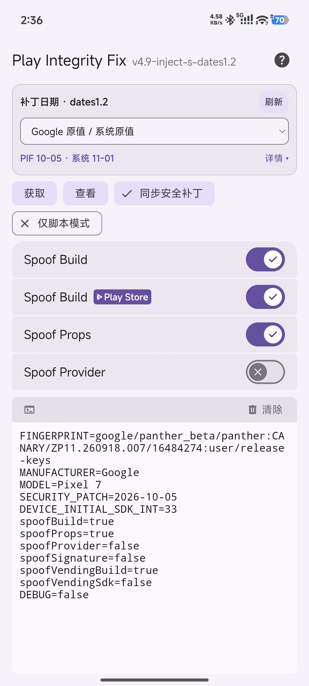
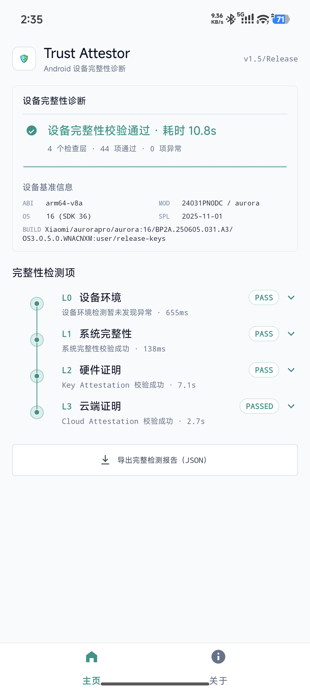
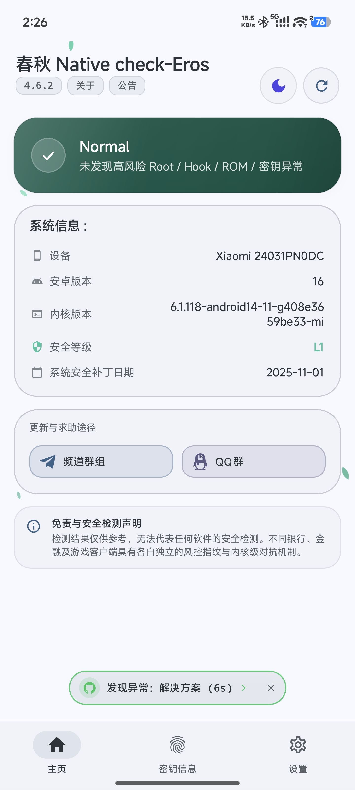
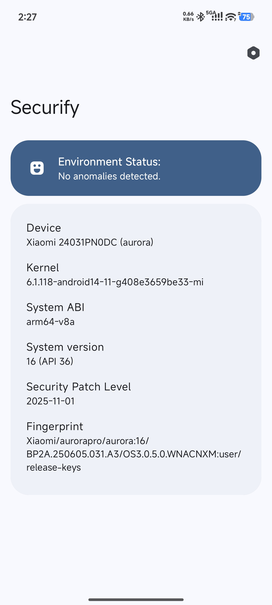

# Play Integrity Fix · 日期管理增强版

基于 PIF v4.9 inject-s，加入补丁日期模式、TS-OSS 日期联动和紧凑版 WebUI。指纹更新、日期设置、同步状态和运行输出集中在一个界面里，日常调整更方便。

基于版本：**v4.9-inject-s**。增强维护：[Moderate-Qi](https://github.com/Moderate-Qi)。

## 相比原版增加

- **Google 原值／系统原值。** Google Play 服务和 Play 商店沿用 Pixel 配置中的补丁日期，系统及普通应用沿用当前固件的原始补丁日期，两套日期分别管理。
- **四种日期模式。** 支持 Google 原值／系统原值、官方原始日期、day01、自定义日期，直接在 WebUI 中选择。
- **Autopif 自动联动。** 获取新指纹时继续使用已选日期模式，指纹和日期一次更新。
- **配合 TS-OSS 管理证明日期。** 系统、Vendor 与 Boot 补丁日期按各自配置同步，Google 应用沿用独立设置。
- **配置备份与开机同步。** 保存调整前的日期配置，开机后继续应用已保存模式。

## 使用方式

1. 从本仓库 Releases 下载 `PlayIntegrityFix-v4.9-inject-s-dates1.2.zip`，在 SukiSU Ultra 中刷入并重启。
2. 进入 PIF WebUI，选择“Google 原值／系统原值”，启用“同步安全补丁”。
3. 选择 Pixel 6–9 对应机型，运行 Autopif，查看下方指纹和同步输出。
4. 配合 TS-OSS、现有 keybox 与目标应用配置使用，完成同步后重启手机。

## 实测环境

小米 14 Ultra，HyperOS 3.0.5.0，Android 16，SukiSU Ultra v4.3.0 / 41131-6（LKM），Zygisk Next 1.5.2（864），LSPosed 2.2.1（7912）。系统原始安全补丁日期为 2025-11-01。

## 界面与实测截图

### PIF dates1.2：日期模式与运行输出

### Trust Attestor 1.5：四层通过，44 项通过

### 春秋 4.6.2：Normal

### Securify：环境结果与系统原始日期

## 来源、版权与许可证

上游项目：[PIF v4.9 inject-s；chiteroman、KOWX712 及原项目贡献者](https://github.com/KOWX712/PlayIntegrityFix)。功能增强、集成和文档由 Moderate-Qi 维护，保留原作者署名与第三方版权记录。

[GPL-3.0](LICENSE)。具体修改、来源和构建入口见 [CHANGELOG_LOCAL.md](CHANGELOG_LOCAL.md)、[NOTICE.md](NOTICE.md) 和 [BUILDING.md](BUILDING.md)。

## 配套项目

- [TS-OSS 199 兼容增强版](https://github.com/Moderate-Qi/TrickyStoreOSS)
- [HMA-OSS UID 一体化增强版](https://github.com/Moderate-Qi/HMA-OSS-UID)
- [DuckUSB Service 服务增强版](https://github.com/Moderate-Qi/DuckUSB-Service)
- [TrickyAddon 目标管理增强版](https://github.com/Moderate-Qi/TrickyAddon)

## 免责声明

如有侵权请联系我删除。

仅代表本人使用的当前系统和当前环境下的实测结果，且通过相关检测器不代表所有软件都检测不到环境异常，请勿用于游戏作弊等场景。
